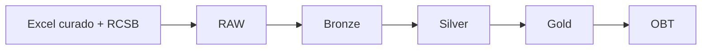

# Afinidad proteína-proteína

Este proyecto transforma mediciones experimentales de afinidad y estructuras 3D de proteínas en una tabla para análisis y futuros modelos de machine learning.

El pipeline descarga los datos, valida su calidad y calcula características químicas y geométricas. El resultado es una **One Big Table (OBT)**: una fila por observación experimental, con su afinidad, características y procedencia.

La ejecución validada conserva **12 062 observaciones y 280 columnas**. Estas columnas incluyen características, etiqueta y trazabilidad; no todas son entradas para un modelo.

## Cómo funciona



| Etapa | Qué hace |
|---|---|
| Ingesta y RAW | Descarga estructuras y metadatos desde RCSB; conserva los archivos originales y las mediciones. |
| Bronze | Organiza los registros y convierte tipos sin eliminar observaciones. |
| Silver | Valida participantes y calcula distancias, composición química, ángulos y longitudes. |
| Gold | Organiza las observaciones y sus características en un modelo de hechos y dimensiones. |
| OBT | Une las tablas de Gold con Spark y publica el resultado en Snowflake. |

**Kestra** coordina las etapas. **Python** descarga archivos y calcula geometría; **dbt** transforma y valida tablas en **Snowflake**. **Spark** realiza las uniones finales. Los programas se ejecutan en contenedores Docker; Spark y los cálculos estructurales usan CPU local. PostgreSQL guarda el estado interno de Kestra.

## Datos y alcance

La fuente inicial es el [dataset principal PPB-Affinity](https://zenodo.org/records/14271435): 12 062 mediciones asociadas a 3 032 códigos PDB distintos. La colección AlphaFold queda fuera del proyecto.

Las estructuras y los metadatos se obtienen de RCSB. En la ejecución validada se recuperaron las 3 032 estructuras y 3 026 JSON de metadatos. Las seis ausencias de metadatos se registran sin descartar las observaciones.

La selección de residuos usa la **distancia mínima entre Cα de participantes distintos**. Se calcula el primer cuartil por participante y se seleccionan los residuos cuya distancia es menor que ese umbral. No se utiliza un corte fijo de 25 Å.

## Empezar en otra máquina o cuenta

Se necesitan Python 3.9 o superior, OpenSSL, Docker con Compose y una cuenta de Snowflake con permisos para preparar los objetos del proyecto.

Seguir la **[guía de reproducción](docs/14_pipeline_reproducible.md)**. Allí se explica cómo:

1. Crear la configuración local y las credenciales propias.
2. Ejecutar los scripts iniciales en la cuenta de Snowflake.
3. Construir las imágenes y levantar Kestra.
4. Ejecutar el pipeline completo.

No hace falta acceder a la cuenta de Snowflake del autor ni disponer de sus estructuras descargadas.

## Ejecutar el pipeline

Una vez completada la configuración, ejecutar desde la raíz del repositorio:

```sh
python3 scripts/project.py run
```

Este comando publica el flujo en Kestra y procesa la fuente histórica completa. La ejecución se inicia bajo demanda: la curación de nuevas mediciones es manual y las etapas posteriores son automáticas.

### Incorporar nuevas mediciones

Crear una plantilla vacía:

```sh
python3 scripts/project.py template
```

Completarla, guardarla como un lote nuevo y ejecutar:

```sh
python3 scripts/project.py run --mode curated --input data/incoming/lote_002.xlsx
```

El contrato de columnas y unidades está en la [guía de ingreso de lotes](docs/14_pipeline_reproducible.md). Una lista de códigos PDB por sí sola no contiene las afinidades necesarias.

### Repetir un lote anterior

```sh
python3 scripts/project.py run --mode replay --input data/rcsb/batches/IDENTIFICADOR_DEL_LOTE
```

Este modo reutiliza los originales del lote y comprueba que la carga no duplique sus registros. Requiere conservar sus archivos y manifiestos locales. Un Excel modificado se considera una versión distinta; el pipeline no deduplica científicamente observaciones entre versiones.

## Resultado y validación

La tabla final es `PROTEIN_AFFINITY.ANALYTICS.OBT_AFFINITY`.

| Comprobación de la ejecución documentada | Resultado |
|---|---:|
| Etapas de Kestra completadas | 11 |
| Pruebas de dbt aprobadas | 123 de 123 |
| Filas de la OBT | 12 062 |
| Columnas de la OBT | 280 |
| Identificadores de observación únicos | 12 062 |

También se verificaron la repetición de las transformaciones, la conservación de observaciones y la coincidencia de las 280 columnas con una unión SQL independiente de Gold.

Consultar la [evidencia de ejecución y backfill](docs/15_pipeline_validation.md). Los informes detallados se generan en `reports/pipeline/<ID_Kestra>/` y permanecen fuera de Git.

## Dónde encontrar el código

| Ruta | Contenido |
|---|---|
| [scripts/project.py](scripts/project.py) | Comandos de preparación y ejecución. |
| [kestra/affinity_pipeline.yml](kestra/affinity_pipeline.yml) | Flujo completo, entradas y reintentos. |
| [scripts/](scripts/) | Ingesta, validaciones y cálculos estructurales. |
| [dbt/](dbt/) | Modelos y pruebas de Bronze, Silver y Gold. |
| [spark/](spark/) | Construcción y validación de la OBT. |
| [sql/](sql/) | Preparación de Snowflake y consultas de inspección. |
| [tests/](tests/) | Pruebas de Python y Spark. |

## Documentación

- [Reproducir el proyecto e ingresar lotes](docs/14_pipeline_reproducible.md).
- [Selección de residuos y geometría de interfaz](docs/09_silver.md).
- [Características químicas](docs/10_chemical_features.md).
- [Ángulos y longitudes del esqueleto proteico](docs/11_backbone.md).
- [Modelo de Gold](docs/12_gold.md) y [construcción de la OBT](docs/13_obt.md).
- Diccionario de las 280 columnas: [Markdown](docs/obt_data_dictionary.md) o [JSON](docs/obt_data_dictionary.json).

## Qué se guarda en Git

El repositorio contiene código, configuración de ejemplo, pruebas, documentación y evidencia resumida. Los datos descargados, archivos Excel, cachés, reportes completos y credenciales están excluidos mediante `.gitignore`.

El pipeline descarga nuevamente la fuente publicada y los recursos de RCSB. Para reproducir exactamente una versión histórica, conservar sus originales fuera de Git: RCSB puede actualizar los archivos entre descargas.

## Límites actuales

Se conservan las observaciones con problemas estructurales o de anotación, señaladas mediante estados de calidad. No se certifica el ensamblaje biológico ni se modelan automáticamente todas las mutaciones.

El proyecto llega hasta la preparación de datos. La selección de variables, el control de similitud entre entrenamiento y prueba, y el entrenamiento de modelos quedan para una etapa posterior.
