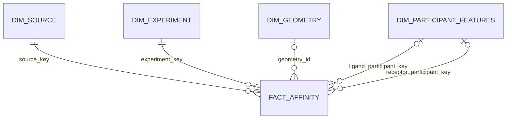

# Gold: esquema estrella para afinidad

Gold organiza las ocho tablas Silver en cinco tablas analiticas. Los resultados reales y las pruebas estan en `reports/gold.md`.

## Grano y relaciones

La tabla central **FACT_AFFINITY tiene una fila por OBSERVATION_ID del Excel**. No es una fila por PDB, geometria, proteina ni pareja de participantes. Dos mediciones del mismo complejo siguen siendo dos filas.



| Tabla | Grano | Informacion |
|---|---|---|
| FACT_AFFINITY | Observacion original | Kd, pKd, claves de dimensiones, mutaciones, nombres y cadenas reportadas, procedencia de la fila y estados de calidad |
| DIM_SOURCE | Archivo/version + hoja + dataset | Archivo y conjunto de origen; permite comparar cobertura por fuente |
| DIM_EXPERIMENT | Combinacion exacta del contexto reportado | Metodo, temperatura, referencia y fecha de afinidad; conserva anotaciones de ausencias y supuestos |
| DIM_GEOMETRY | Archivo estructural + grupos de cadenas + version de calculo | Seleccion Q1, distancias y conteos generales; conserva fallos |
| DIM_PARTICIPANT_FEATURES | GEOMETRY_ID + L/R | Resumenes quimicos y de backbone; prefijos CHEM_ y BACKBONE_ distinguen sus origenes |

DIM_PARTICIPANT_FEATURES se usa dos veces en la estrella: una como ligando y otra como receptor. La dimension tiene dos filas por geometria, pero cada clave de rol del hecho apunta a una sola fila. No se une usando solamente GEOMETRY_ID.

L/R son los grupos de cadenas definidos por el dataset; un participante puede contener varias cadenas. PARTICIPANT_KEY no es una identidad universal de proteina. GEOMETRY_ID tampoco identifica necesariamente una interfaz biologica unica.

## Claves y contextos

OBSERVATION_ID y GEOMETRY_ID se heredan de Silver. PARTICIPANT_KEY concatena GEOMETRY_ID y el rol con ':'. SOURCE_KEY y EXPERIMENT_KEY usan SHA-256 de un array JSON de campos ordenados, conservando NULL. Las claves no dependen del orden de las filas.

DISTINCT se usa solo en las dimensiones de fuente y contexto. Que dos observaciones compartan EXPERIMENT_KEY significa que coinciden los campos disponibles; **no demuestra que procedan del mismo ensayo**. No se inventan pH, solvente o condiciones ausentes. Los originales completos siguen en Silver/RAW.

## Casos incompletos y conservacion

- Si Silver no tiene GEOMETRY_ID, el hecho conserva su fila con claves de geometria y participantes NULL. Las futuras uniones deben ser LEFT JOIN.
- Si hay GEOMETRY_ID pero fallo el calculo, Gold conserva la geometria y ambos participantes, junto con estados y features NULL.
- La quimica y geometria interna se proyectan exactamente desde Silver. No se cambia Q1, no se imputan valores, no se recalculan atomos y no se aplican mutaciones.
- Las cadenas, parametros y grupos se serializan a texto JSON en las dimensiones para facilitar su lectura posterior en Spark. Los valores originales permanecen en Silver.

## Indicadores del hecho

| Campo | Significado |
|---|---|
| HAS_VALID_LABEL | Silver marco KD_STATUS='valid' |
| HAS_COMPUTED_GEOMETRY | Silver marco GEOMETRY_STATUS='computed' |
| HAS_Q1_BOTH_PARTNERS | Ambos participantes tienen al menos un residuo seleccionado |
| NEEDS_VARIANT_REVIEW | El estado de mutacion no es not_annotated ni target_residues_present, o esta ausente |

Estos indicadores no son una aprobacion automatica para entrenar. `target_residues_present` solo significa que se encontraron los residuos objetivo; no demuestra que toda la estructura reproduzca el mutante. `not_annotated` no prueba ausencia de mutaciones. La afinidad y las features siguen vinculadas a la evidencia disponible.

No se eliminan observaciones por estos indicadores. No se hace train/test split, imputacion, escalado ni agrupacion por homologia. Identificadores, referencias, fuente, estados de calidad y etiqueta deben mantenerse como contexto, no incorporarse automaticamente a X. Kd y pKd nunca deben usarse como predictores de pKd.

## Contrato para Spark

1. Leer FACT_AFFINITY como tabla base.
2. LEFT JOIN con DIM_SOURCE por SOURCE_KEY y con DIM_EXPERIMENT por EXPERIMENT_KEY.
3. LEFT JOIN con DIM_GEOMETRY por GEOMETRY_ID.
4. Leer DIM_PARTICIPANT_FEATURES con alias L y R y unir por LIGAND_PARTICIPANT_KEY y RECEPTOR_PARTICIPANT_KEY, respectivamente.
5. Proyectar las features con prefijos LIGAND_ y RECEPTOR_; evitar nombres duplicados.
6. Verificar una fila por OBSERVATION_ID, mismo universo de IDs, mismo Kd/pKd y ausencia de multiplicaciones.
7. Escribir ANALYTICS.OBT_AFFINITY. Esta etapa esta implementada en un flujo separado: `kestra/build_obt.yml`; ver `docs/13_obt.md`.

Los millones de pares y residuos no se unen directamente al hecho: ya estan resumidos en las dimensiones. Las mediciones detalladas siguen disponibles para investigacion y nuevas features.

La estrella sirve para consultar condiciones, fuentes o estructuras sin repetir sus atributos por observacion. La OBT reunira todas las columnas necesarias en una fila para consumo por ML; conservara la misma granularidad del hecho.

## Construccion y pruebas

Desde `/Users/lenytacuri/protein affinity/pset_2`, con Silver y backbone construidos:

```sh
docker compose up -d postgres kestra
docker compose run --rm pipeline python scripts/kestra_flow.py kestra/build_gold.yml --run --wait
```

Kestra ejecuta `scripts/build_gold.py` dentro de la imagen existente. Python coordina, pero las transformaciones de Gold se ejecutan con **dbt SQL en Snowflake**. Esta etapa no necesita los ocho nucleos locales de calculo estructural.

El runner usa el bloqueo compartido de Silver para impedir construcciones concurrentes sobre estos artefactos. Registra huellas de RAW, Bronze y las ocho tablas Silver, construye Gold, repite la construccion y compara conteos/HASH_AGG; finalmente comprueba que las entradas no cambiaron. HASH_AGG es una comprobacion practica de contenido, no un hash criptografico. Los tests comparan ademas claves y valores relevantes directamente.

Pruebas de dominio:

- Unicidad/no nulidad de claves y relaciones entre hechos y dimensiones.
- Conservacion de IDs, afinidades, variantes y estados frente a Silver.
- Contextos exactos, incluyendo NULL, sin fusionar observaciones.
- Correspondencia de participantes L/R, PDB y cantidades Q1.
- Conservacion de todas las features quimicas y de backbone.
- Cardinalidad de las mismas uniones que se usaran en Spark.

Todas las pruebas Gold tienen tag `gold`. Los runners anteriores excluyen estas pruebas para poder reconstruir Silver antes de que Gold exista o se actualice. Los modelos mantienen dependencias mediante ref(); las fuentes RAW siguen declaradas con source().

La reconstruccion es completa y determinista. No es incremental ni una transaccion atomica para todas las tablas. Una ejecucion fallida no debe alimentar Spark: revisar logs y repetir hasta SUCCESS. Las tablas Silver no se modifican.

## Archivos

- `dbt/models/gold/`: cinco modelos y su esquema de pruebas.
- `dbt/macros/gold_keys.sql`: claves de contexto estables.
- `dbt/tests/gold_*.sql`: verificaciones de dominio.
- `scripts/build_gold.py`: ejecucion y evidencia.
- `scripts/gold_report.py`: reporte basado en resultados.
- `kestra/build_gold.yml`: flujo con reintentos.
- `sql/13_view_gold.sql`: shape, ejemplo de join y estados.
- `reports/gold/`: versiones de manifest, logs, catalogo y resultados.

Referencias tecnicas: [seleccion de pruebas dbt](https://docs.getdbt.com/reference/node-selection/test-selection-examples), [HASH_AGG](https://docs.snowflake.com/en/sql-reference/functions/hash_agg), [comparaciones con NULL](https://docs.snowflake.com/en/sql-reference/functions/is-distinct-from).
