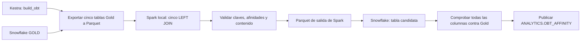

# OBT: uniones reales con Spark local

La tabla final es **PROTEIN_AFFINITY.ANALYTICS.OBT_AFFINITY**. Su grano es una observacion experimental original (OBSERVATION_ID), igual que FACT_AFFINITY. El resultado validado esta en `reports/obt.md`.

## Flujo implementado



El conector de Snowflake para Python solo transporta los datos: exporta tablas individuales usando Arrow y carga los archivos que escribio Spark. **No se usa pandas.merge ni SQL para construir la OBT**. La comparacion SQL final es una verificacion independiente del resultado.

Parquet conserva tipos, decimales y ausencias. La carga usa los tipos originales de Gold, no infiere NUMBER a partir de unos pocos valores. No se reemplaza NULL por cero, cadenas vacias o medias.

## Computadora y recursos

- Spark 4.0.1, Python 3.12 y Java 21 dentro de `protein-affinity-pset2-spark:local`.
- Modo local, por defecto un hilo de tarea por CPU disponible (8 en esta Mac).
- El servicio Compose tiene `SPARK_MASTER=local[8]` y ocho particiones de intercambio; Kestra usa el mismo script e imagen y detecta los CPU disponibles.
- La JVM del driver tiene 2 GB de heap; Python y buffers usan memoria adicional. No se reserva toda la RAM de Docker.
- Las dimensiones son pequenas y se distribuyen con broadcast dentro de Spark. El resultado se escribe en ocho particiones.
- No hay ocho contenedores ni ocho computadoras. Hay un proceso Spark local con tareas paralelas; Kestra y PostgreSQL son servicios separados.

La ingesta por Arrow se escribe por lotes a disco, sin juntar toda una tabla en pandas. Aun asi, este transporte local esta pensado para el ejercicio. Para terabytes cambiariamos a almacenamiento compartido/cloud y un conector distribuido con Spark en cluster.

## Uniones y columnas

`spark/obt_transform.py` define las cinco uniones:

| Tabla/rol | Clave del hecho | Clave de dimension |
|---|---|---|
| DIM_SOURCE | SOURCE_KEY | SOURCE_KEY |
| DIM_EXPERIMENT | EXPERIMENT_KEY | EXPERIMENT_KEY |
| DIM_GEOMETRY | GEOMETRY_ID | GEOMETRY_ID |
| DIM_PARTICIPANT_FEATURES como ligando | LIGAND_PARTICIPANT_KEY | PARTICIPANT_KEY |
| DIM_PARTICIPANT_FEATURES como receptor | RECEPTOR_PARTICIPANT_KEY | PARTICIPANT_KEY |

Todas son LEFT JOIN. Un complejo puede tener varias observaciones; estas se conservan. Los tres casos sin GEOMETRY_ID conservan su fila, con columnas estructurales ausentes. Las geometrias fallidas conservan sus estados de Silver/Gold.

Se mantienen todas las columnas del hecho. Se agregan las columnas de fuente, contexto experimental y geometria que no esten ya en el hecho. Cada participante agrega sus medidas con prefijo **LIGAND_** o **RECEPTOR_**. El archivo `reports/obt/<run>/column_lineage.json` indica de que tabla y columna Gold procede cada columna de la OBT.

## Verificaciones antes de publicar

1. Claves primarias no nulas y unicas en las cinco entradas.
2. Claves foraneas no nulas deben existir en su dimension. Los NULL estructurales se permiten.
3. Igual numero de filas antes/despues de los joins y OBSERVATION_ID unico.
4. Igualdad de todas las columnas originales del hecho, incluidos IDs, Kd, pKd, mutaciones y estados.
5. Repeticion de las uniones Spark cambiando las particiones: comparacion en ambos sentidos con exceptAll.
6. Escritura/lectura de Parquet sin diferencias en ninguna columna.
7. Tras cargar, comparar todas las columnas contra un join independiente de Gold en Snowflake en ambos sentidos; verificar tambien cantidad y unicidad.
8. Comprobar que RAW, Bronze, Silver y Gold conservan sus conteos y huellas.

Las pruebas pequenas de `tests/test_obt.py` comprueban roles diferentes L/R, observaciones del mismo complejo, geometria NULL y rechazo de dimensiones duplicadas, referencias huerfanas o afinidades modificadas.

Se guarda plan de ejecucion y eventos Spark, ademas del esquema, linaje, archivos de entrada y resumen. Los datos locales intermedios quedan en `data/obt/<run>/`; los Parquet enviados a Snowflake en `ANALYTICS.OBT_FILES/<run>/`.

## Publicacion y repeticion

La carga se hace en una tabla candidata `ANALYTICS.OBT_BUILD_<run>`. Solo despues de validarla se publica con `CREATE OR REPLACE TABLE ... CLONE ... COPY GRANTS`, que reemplaza atomicamente la OBT. Si falla antes, la OBT anterior permanece disponible. La tabla candidata de una ejecucion exitosa se elimina; una fallida puede conservarse para diagnostico.

La OBT se reconstruye completa, no se agregan filas por append. Repetir con los mismos datos y columnas debe conservar su huella. Si hay una ejecucion anterior con las mismas entradas, se verifica esa igualdad antes de publicar. El bloqueo local compartido evita superponer construcciones del proyecto; cambios externos en Gold se detectan mediante verificaciones de contenido, pero no se implementa una transaccion distribuida entre las exportaciones y Snowflake.

HASH_AGG es una comprobacion practica de contenido, no criptografica. Los Parquet de entrada tambien tienen SHA-256 y las validaciones comparan directamente IDs y valores.

## Ejecutar

Desde `/Users/lenytacuri/protein affinity/pset_2`, despues de Gold:

```sh
# Las imagenes anteriores son la base de la imagen Spark.
docker compose build audit dbt
docker compose build geometry
docker compose build spark
docker compose up -d postgres kestra
docker compose run --rm pipeline python scripts/kestra_flow.py kestra/build_obt.yml --run --wait
```

Para ejecutar directamente sin Kestra:

```sh
docker compose run --rm spark
```

Pruebas pequenas (no escriben en Snowflake):

```sh
docker compose run --rm spark python -m unittest discover -s tests -p test_obt.py -v
```

## Consumo para ML y limites

PKD es la etiqueta a predecir. KD_M y KD_M_RAW contienen la misma informacion experimental y no deben incluirse como predictores. Identificadores, referencias, datasets, estados y trazabilidad se conservan para auditar; no son automaticamente entradas del modelo.

La OBT no aplica imputacion, escalado, seleccion de variables, cluster de homologia ni train/test split. Las mutaciones no modeladas, estructuras no utilizables y cobertura parcial siguen marcadas. Que una observacion este en la OBT no la hace automaticamente elegible para entrenar.

El esquema estrella Gold sirve para explorar y mantener relaciones; la OBT facilita consumir una fila con todas las variables. Aunque ambas son productos analiticos, se separan aqui para respetar la secuencia de la tarea: dbt Gold -> Spark OBT.

Referencias: [Spark 4.0.1 y modo local](https://spark.apache.org/docs/4.0.1/), [API del conector Python](https://docs.snowflake.com/en/developer-guide/python-connector/python-connector-api), [carga Parquet](https://docs.snowflake.com/en/sql-reference/sql/copy-into-table).

## Diccionario completo

Las 280 columnas están documentadas en `docs/obt_data_dictionary.md` y `docs/obt_data_dictionary.json`. Cada definición incluye tipo, unidades, fórmula cuando corresponde, significado de NULL, procedencia y orientación de uso en ML.
