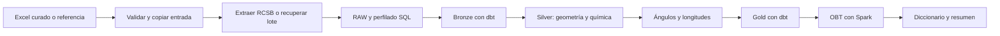

# Pipeline bajo demanda y reproducción

La curación científica ocurre **antes** de ingresar el lote. Una persona identifica
la medición experimental, sus unidades, el PDB y los participantes. Al entregar ese
Excel, Kestra ejecuta automáticamente el trabajo hasta la OBT. No se inventan
mediciones ni se programa una búsqueda diaria de papers.

## Qué ejecutar

Desde la raíz del proyecto, con Docker abierto y la configuración inicial hecha:

```sh
python3 scripts/project.py run
```

Publica y ejecuta `protein.affinity/affinity_pipeline`, espera su resultado y guarda
el ID de ejecución. El modo predeterminado `reference` descarga y verifica el Excel
principal de Zenodo (12 062 observaciones); excluye la colección AlphaFold. Descarga
los metadatos y coordenadas desde RCSB, reutilizando objetos locales íntegros si existen.
No requiere las carpetas ATLAS/SKEMPI descargadas anteriormente.

El mismo flujo se puede abrir en Kestra, `http://localhost:8080`, elegir **Execute**
y completar `mode`, `input_path` y `refresh`. La primera ejecución desde el comando
publica el YAML; las posteriores actualizan su definición antes de ejecutarlo.

| Modo | Entrada | Uso |
|---|---|---|
| `reference` | Sin ruta | Carga histórica completa de la fuente publicada. |
| `curated` | Ruta a un Excel dentro del proyecto | Nuevas observaciones curadas. |
| `replay` | Carpeta exacta de un lote previamente extraído | Repetir/reprocesar ese lote con sus originales y reconstruir las capas. |

`refresh=false` conserva las versiones cacheadas. `refresh=true`, solo en reference
o curated, consulta de nuevo RCSB y conserva nuevas versiones si cambiaron. RCSB es
una fuente viva: descargar en otra fecha no garantiza bytes idénticos. El replay de
un lote conserva sus hashes originales y exige que sus objetos sigan disponibles.

## Arranque en la cuenta de Snowflake del evaluador

Requisitos: Python 3.9 o superior en el host, OpenSSL, Docker con Compose v2,
acceso a Internet y una cuenta propia de Snowflake con permisos para preparar
los objetos del proyecto. Las dependencias científicas se instalan en las imágenes.
La ejecución verificada usa Docker Desktop con 8 CPU y aproximadamente 8 GB de RAM.
Spark corre localmente en Docker; Snowflake ejecuta SQL/dbt en un warehouse XSMALL.

1. Obtener el código del proyecto y abrir una terminal en su carpeta raíz.
2. Preparar una configuración **propia**, sin copiar credenciales del autor:

   ```sh
   python3 scripts/project.py setup --account ORGANIZACION-CUENTA
   ```

   Crea `.env` con la cuenta indicada, ruta absoluta del proyecto y contraseñas
   locales aleatorias para Kestra/PostgreSQL. Genera una clave privada local y
   `sql/02_service_user.local.sql` con su clave pública. Si `.env` ya existe,
   se detiene para conservarlo. Si se mueve la carpeta, actualizar `PPA_PROJECT_DIR`.

3. En una hoja SQL de **su propia cuenta de Snowflake**, ejecutar en orden:
   `sql/01_bootstrap.sql` y el archivo generado `sql/02_service_user.local.sql`.
   Requiere SYSADMIN/SECURITYADMIN o permisos equivalentes para ese bootstrap.
   Crea PROTEIN_AFFINITY, las cinco capas, PPA_WH y el acceso PPA_SERVICE limitado
   al proyecto. Si ese usuario ya existe, el segundo SQL falla deliberadamente:
   no reemplaza una clave existente. Administrar ese caso explícitamente.
4. Construir las imágenes, levantar el orquestador y comprobar la conexión:

   ```sh
   python3 scripts/project.py build
   python3 scripts/project.py start
   python3 scripts/project.py check
   ```

   `build` respeta el orden runner/dbt → geometry → spark. `start` levanta Kestra
   y PostgreSQL. El comando de ejecución espera hasta 180 s a que la API de Kestra termine de iniciar.
   Las credenciales de acceso local están en `.env`; no se imprimen en los comandos.
5. Ejecutar la fuente histórica completa:

   ```sh
   python3 scripts/project.py run
   ```

Resultado esperado: las tablas en las cinco capas y
`PROTEIN_AFFINITY.ANALYTICS.OBT_AFFINITY`, con una fila por observación conservada.
En el dataset original se esperan 12 062 filas y 280 columnas; una base que ya
contenga otros lotes incluirá también esas observaciones. No hace falta que el
profesor tenga acceso a la cuenta del autor. Los nombres de base, capas y objetos
son los del proyecto; cambiar solo SNOWFLAKE_DATABASE no renombra el SQL existente.

El bootstrap es una preparación inicial. `run` no crea usuarios, no registra claves
y no administra la cuenta. El warehouse consumirá créditos al ejecutar las consultas.

## Ingresar un lote nuevo

Crear una plantilla vacía que use los nombres de columnas reconocidos:

```sh
python3 scripts/project.py template
```

Se guarda en `data/incoming/plantilla_mediciones.xlsx`; nunca sobrescribe un archivo
existente. Completarla y guardar el lote, por ejemplo como `lote_002.xlsx`:

```sh
python3 scripts/project.py run --mode curated --input data/incoming/lote_002.xlsx
```

Solo se lee la **primera hoja**. Cada fila es una observación experimental.
Columnas requeridas: `Source Data Set`, `Complex ID`, `PDB`, `Ligand Chains`,
`Receptor Chains`, `KD(M)`. Source Data Set, Complex ID y PDB deben tener valores;
Complex ID debe distinguir las observaciones dentro del mismo archivo. PDB puede
repetirse. Las cadenas distinguen mayúsculas/minúsculas y deben corresponder a la
estructura depositada. Usar la notación de grupos del Excel original.

`KD(M)` es Kd en mol/L, no Ka ni pKa. Si el paper publica nM, convertir a mol/L
antes de entregar la tabla y documentar esa conversión en la curación. Si publica
pKd, Kd(M)=10^(−pKd). No completar datos desconocidos con valores inventados.
El pipeline conserva afinidades/cadenas faltantes o inválidas y las señala en
las capas posteriores; tener una fila en la OBT no significa que pueda entrenar.

Columnas opcionales reconocidas: Mutations, Ligand Name, Receptor Name,
Affinity Method, Structure Method, Temperature(K), Resolution(Å), PDB PubMed ID,
PDB Release Date, Affinity PubMed ID, Affinity Release Date y Subgroup.
Affinity PubMed ID conserva la referencia de la medición (puede ser texto de
referencia si no existe PubMed ID). Los campos adicionales permanecen en RAW,
pero necesitan modelado explícito para convertirse en columnas de la OBT.

No usar la colección AlphaFold como entrada: el flujo exige entradas RCSB y no
incluye un lector de estructuras AlphaFold locales. Una lista de PDB sin afinidades
puede descargarse con el extractor independiente, pero no cumple el contrato del
flujo completo de mediciones.

## Duplicados, actualizaciones y backfill

- Repetir **el mismo lote** no duplica las filas: RAW usa MERGE con claves de origen;
  la ejecución verifica la repetición. El identificador PDB no es la clave de una medición.
- La clave de observación depende del SHA-256 del Excel, hoja y número de fila.
  Volver a guardar el Excel puede cambiar su hash: se considera otra versión, incluso
  si varias celdas siguen iguales. No hay deduplicación científica entre versiones.
- Para incorporar nuevos resultados, entregar solo las nuevas observaciones en otro
  lote. Una corrección de un lote anterior requiere decidir explícitamente cómo
  representar/sustituir versiones; el pipeline actual conserva ambas.
- RAW es acumulativa. Las tablas Bronze/Silver/Gold y la OBT se reconstruyen sobre
  todas las mediciones acumuladas. Los cálculos estructurales reutilizan caché por
  contenido, participantes, código y parámetros. Esto es ingesta por lotes con
  reconstrucción posterior, no una actualización incremental de todas las capas.
- El backfill del proyecto es la carga de observaciones históricas mediante la misma
  ruta de procesamiento. No hay particiones diarias ni se inventan fechas. `reference`
  carga la historia publicada; `replay` demuestra que se puede reprocesar un lote.

Para repetir un lote, usar su carpeta exacta (el identificador aparece en el resumen):

```sh
python3 scripts/project.py run --mode replay --input data/rcsb/batches/IDENTIFICADOR_DEL_LOTE
```

El replay requiere los manifiestos, la copia del Excel y los objetos originales en
`data/rcsb/objects/`. No consulta RCSB para reemplazar objetos ausentes por versiones
actuales. Conservar estas carpetas o recuperarlas de los originales archivados.

## Etapas y evidencia



El flujo guarda `reports/pipeline/<ID_Kestra>/summary.md` y `summary.json`, más
logs y una copia de la evidencia de cada etapa. `reports/pipeline/latest.json`
apunta a la última ejecución completa. Si falla dentro del controlador, quedan el recibo FAILED y el log
de la tarea; los errores de arranque del contenedor se consultan en Kestra. No se crea un resumen SUCCESS. Kestra conserva su estado e historial.

Cada ejecución copia su entrada y pasa el lote exacto a RAW mediante un recibo
propio. No depende de `latest_batch.json` para decidir qué cargar. Dos ejecuciones
del flujo principal se encolan. Las tareas reintentan fallos hasta dos veces con
intervalos de 30 s; las descargas tienen además sus propios reintentos. Si una
validación científica o de integridad falla, hay que corregir su causa.

No lanzar simultáneamente los flujos individuales de mantenimiento contra las
mismas tablas: sus bloqueos son por etapa, no una transacción global. El pipeline
completo tampoco es una transacción única: un fallo puede dejar las capas superiores
con la versión anterior. Consultar únicamente una OBT publicada por una ejecución
completa validada; su publicación final verifica contenido antes de sustituirla.

El modo `--no-wait` devuelve el ID sin esperar; cerrar el terminal no cancela el
trabajo en Kestra. La espera normal llega hasta 12 h; si se agota, revisar ese ID
antes de volver a lanzar una ejecución.

## Alcance de la comprobación

Las pruebas del contrato están en `tests/test_pipeline.py` (sin credenciales).
La evidencia de una ejecución completa identifica la cuenta configurada y los
recursos disponibles en ese entorno. No equivale a afirmar que se haya probado
otra cuenta del evaluador. La reproducción requiere su bootstrap, credenciales,
recursos Docker y acceso a las fuentes; los resultados científicos pueden cambiar
si RCSB publica otra versión. El memo final del curso se prepara por separado.

## Archivos principales

- `kestra/affinity_pipeline.yml`: orden, entradas, imágenes, reintentos y concurrencia.
- `scripts/project.py`: comando de preparación y ejecución desde el host.
- `scripts/pipeline_stage.py`: copia de entrada, traspaso exacto de lote y recibos.
- `scripts/batch_contract.py`: columnas requeridas y generación de plantilla.
- `scripts/extract_rcsb.py`: descarga; `--result-file` devuelve el lote de esa ejecución.
- `sql/01_bootstrap.sql`: preparación inicial en cualquier cuenta autorizada.
- `.env.example`: configuración sin credenciales reales.

Referencias de implementación: [tareas Shell de Kestra](https://kestra.io/plugins/plugin-script-shell/io.kestra.plugin.scripts.shell.commands)
y [salidas entre tareas](https://kestra.io/docs/how-to-guides/shell).

La ejecución integrada verificada y sus límites se documentan en [la evidencia de validación](15_pipeline_validation.md).
